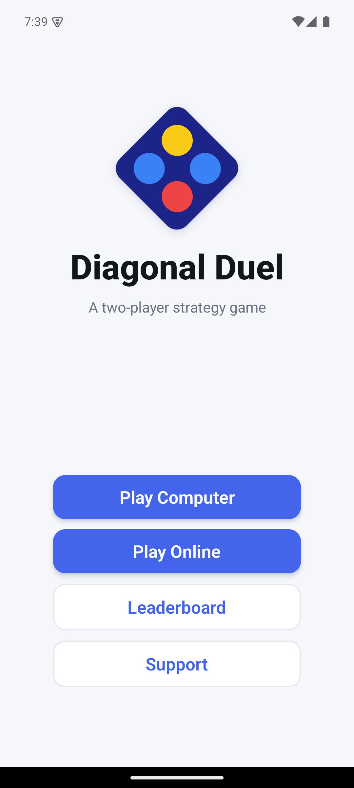
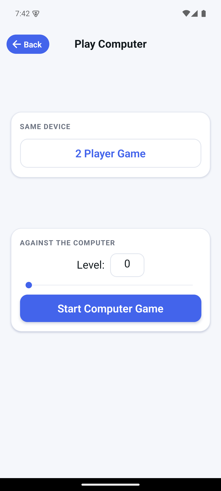
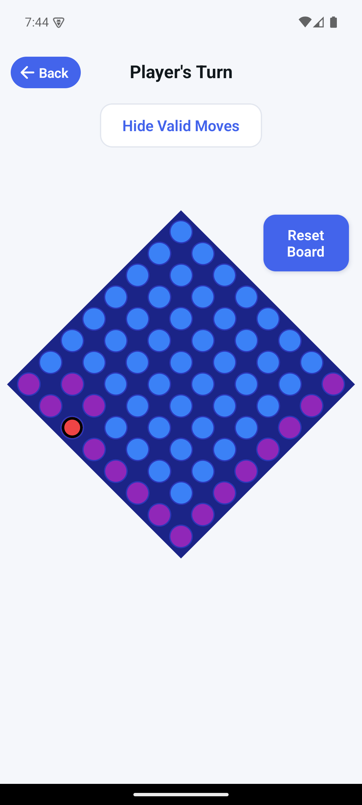
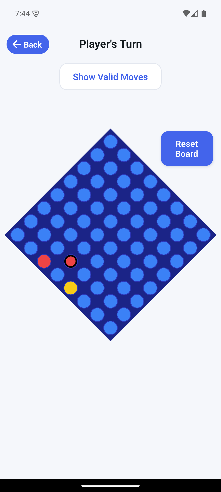

# Diagonal Duel

A two-player strategy board game for iOS and Android. Players take turns placing pieces on an 8×8 board, and the first to line up **four in a row** – horizontally, vertically or diagonally – wins. Play a computer opponent at any of 101 difficulty levels, a friend on the same device, or a rated online opponent.

<p>   </p>

## Why it exists

<!-- TODO: in your own words, why you built it (the story behind the game and its name) -->

## The rules

- The board is 8×8 and the two players alternate turns, one piece per turn.
- A piece can only be placed on a square that is **connected to the pieces already in play**: any square in the first row or first column, or a square that touches an existing piece diagonally up-left, directly above, or directly left of it. Pieces therefore grow out from the top-left corner, and "Show Valid Moves" highlights the legal squares.
- Four of your pieces in a straight line – row, column or diagonal – wins.

<!-- TODO: add anything the code doesn't show – how the name "Diagonal Duel" came about, strategy tips, who moves first online -->

## Game modes

- **Play Computer** – choose a level from 0 to 100. Beating the computer earns leaderboard points equal to the level.
- **2 Player Game** – pass-and-play on one device.
- **Play Online** – matchmaking against another registered player. Games are asynchronous: each move has a time limit (default one day), and the home list shows games where it is your turn, their turn, and completed. Online games change both players' Elo rating.
- **Leaderboard** – top players by online rating and by computer points.
- **Accounts and support screen.**

## Stack

- React Native 0.76 / Expo SDK 52, TypeScript, Expo Router
- Talks to [DiagonalDuelBackend](https://github.com/bsav0016/DiagonalDuelBackend) (Django REST) for accounts, matchmaking, game state and leaderboards

## How the computer opponent works

`features/game/models/GameAI.tsx` blends three kinds of move, with probabilities that depend on the level:

- an **alpha-beta search with iterative deepening**, capped at about 550 ms per move, scored by a heuristic that rewards two-, three- and four-in-a-row (`features/game/scoreUtils.tsx`) and prefers central squares;
- a **one-move heuristic** pick;
- a **random legal move**.

The mix is a function of the level. At level 0 about 80% of moves are the one-move heuristic pick, 10% searched and 10% random. The searched share grows with the level and reaches 100% at level 100, while the random share is largest (about 30%) around level 50.

## Running it

```bash
npm install
npm start            # expo start
npm run android      # or npm run ios / npm run web
```

Computer and 2-player modes run entirely on the device. Accounts, online play and the leaderboard need the backend. The backend address is set in `lib/networkRequests/NetworkConstants.tsx`: `DEV_ENV` is `false`, so the app talks to the hosted production server. To use a local backend, set `DEV_ENV` to `true` and change the development URL to your machine's address.

## Design decisions

- **The game logic lives in the client for offline modes and on the server for online play.** The server re-checks every online move, so the client is not trusted.
- **Asynchronous online games** with per-move time limits, so players don't need to be online at the same time.
- **Adjustable AI strength** by mixing search, heuristic and random moves instead of just limiting search depth.

## Limitations

- Only a placeholder snapshot test exists (`components/__tests__`); the game logic has no automated tests.
- The same win/valid-move rules are implemented twice (client in TypeScript, server in Python), so they must be kept in sync by hand.
- <!-- TODO: is the hosted backend still running? Last upstream commit before this work was Feb 2025. -->

## License

MIT. See [LICENSE](LICENSE).
