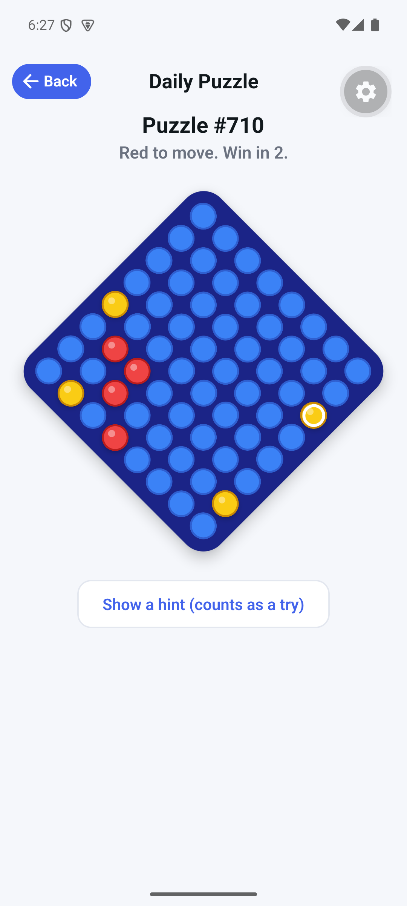
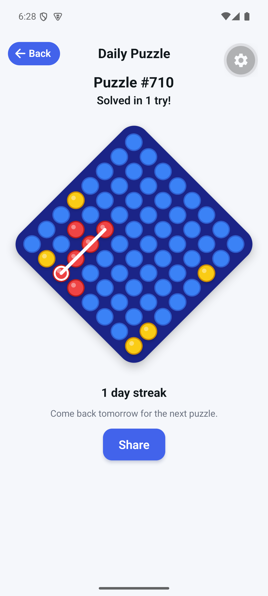
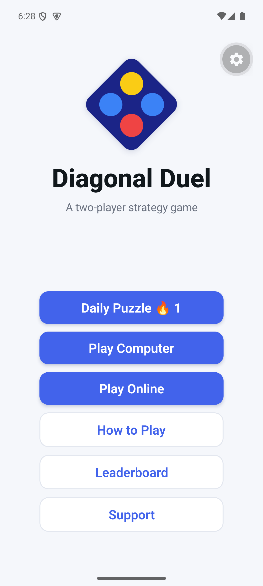

# Daily puzzles: how the bank is made

The daily puzzle is one position a day where the side to move can force four in a row within 1, 2 or 3 of its own moves. The positions are made ahead of time by a script and shipped with the app in `data/puzzles.json`; nothing is generated on a phone or a server.

## What is in the bank

`data/puzzles.json` holds 728 puzzles, two years' worth. Each has the moves that reach the position (so it is always a position the real game can reach), who is to move, the depth, and the single winning first move. Day 0 is `epoch` (a Monday); puzzle `i` is for day `i`. Difficulty follows the weekday: win in one on Monday and Tuesday, win in two on Wednesday to Friday, win in three at the weekend (`pattern`).

A puzzle is only accepted when:
- the side to move cannot win at once (so it needs thought), except on the depth-1 days;
- it wins by force against every defence, proven by an exhaustive search (`features/puzzles/engine/solver.js`), not by the computer opponent's heuristic;
- exactly one first move does it, so there is one answer to find;
- the defender has no winning move waiting (so it is not a "block first" puzzle).

## The pieces

- `features/puzzles/engine/rules.js` the game rules as plain code. A test replays random games against the app's own `validateMove` and `checkWinner`, so they cannot drift apart.
- `features/puzzles/engine/solver.js` the forced-win search. A test compares it with a brute-force search that has no shortcuts.
- `scripts/puzzles/generate.js` plays seeded practice games and keeps the positions that qualify.
- `scripts/puzzles/build-bank.js` writes the bank (same seed, same file) or checks it.

## Commands

- `npm run puzzles:check` verifies every puzzle in the bank from scratch.
- `npm run puzzles:build` rewrites the bank. It is deterministic, so the file only changes if the seed, the pattern, the length (`WEEKS` in `build-bank.js`) or the rules change. Any such change gives a different bank from day 0, so do it before the app is released: once people have a streak, the puzzle for a given day must not change. To lengthen a released bank, append a second file instead of regenerating.
- `npm test` runs all of the above, including the whole-bank check.

## In the app

The Daily Puzzle button is first on the home screen (with the current streak). The screen (`app/(screens)/daily-puzzle.tsx`) shows today's puzzle, who is to move and in how many moves the win comes. The player taps a square and confirms; a move that does not keep the forced win costs a try and the board stays, a right move is played and the defender answers with its best defence (taking one of the winning squares when every reply loses anyway), and the puzzle ends on the winning move. A hint shows the winning move and counts as a try.

- Today's puzzle comes from the day number (`features/puzzles/puzzleBank.ts`), counted in local calendar days so it changes at local midnight.
- The streak and results are kept on the phone (`progress.ts`). Only the first solve of a day counts, so replaying changes nothing; a missed day resets the streak.
- Sharing sends the puzzle number, the tries and the streak with the App Store link (`share.ts`). The Play Store link is empty until the Android listing exists, so Android phones are sent the App Store page.

  
